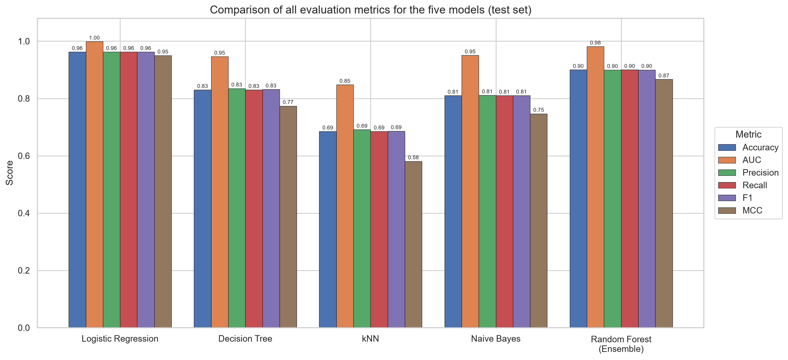
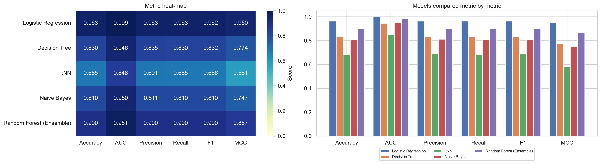
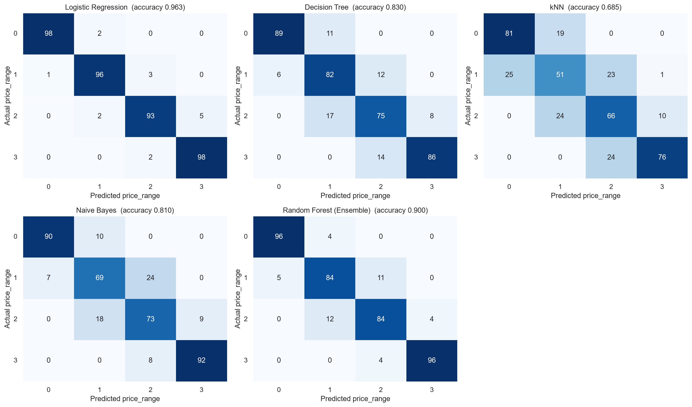
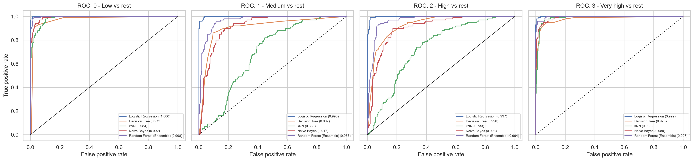
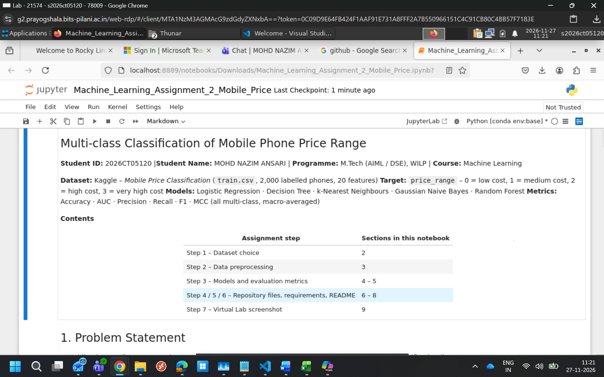

# 2026CT05120_Machine_Learning_Assignment_2

**Student ID:** 2026CT05120 | M.Tech (AIML / DSE), BITS WILP | Course: Machine Learning

## 1. Problem Statement
Predict the price band (0 = low, 1 = medium, 2 = high, 3 = very high cost) of a mobile phone from its technical specification. The problem is a four-class classification task. Five algorithms (Logistic Regression, Decision Tree, kNN, Gaussian Naive Bayes, Random Forest) are trained on the same stratified 80:20 split and compared with Accuracy, AUC, Precision, Recall, F1 and MCC.

## 2. Dataset Description  [1 mark]
- **Source:** Kaggle - Mobile Price Classification (https://www.kaggle.com/datasets/iabhishekofficial/mobile-price-classification), file `train.csv`.
- **Size:** 2000 instances, 20 features (14 numeric, 6 binary), target `price_range`.
- **Why chosen:** it exceeds the minimum of 1,000 instances and 12 features, is a genuine multi-class problem, has interpretable features of mixed type, and hides data-quality issues (impossible zeros) that make preprocessing meaningful.
- **Class distribution:** the classes are balanced (imbalance ratio 1.00 : 1), so no resampling was needed.

| Class | Count | Percentage |
|---|---|---|
| 0 - Low | 500 | 25.00 |
| 1 - Medium | 500 | 25.00 |
| 2 - High | 500 | 25.00 |
| 3 - Very high | 500 | 25.00 |

**Features**

| Feature | Type | Meaning |
|---|---|---|
| battery_power | numeric | Battery capacity (mAh) |
| blue | binary | Has Bluetooth (1 = yes) |
| clock_speed | numeric | Processor clock speed (GHz) |
| dual_sim | binary | Supports dual SIM (1 = yes) |
| fc | numeric | Front camera (megapixels) |
| four_g | binary | Has 4G (1 = yes) |
| int_memory | numeric | Internal memory (GB) |
| m_dep | numeric | Mobile depth / thickness (cm) |
| mobile_wt | numeric | Weight of the phone (g) |
| n_cores | numeric | Number of processor cores |
| pc | numeric | Primary (rear) camera (megapixels) |
| px_height | numeric | Screen resolution height (pixels) |
| px_width | numeric | Screen resolution width (pixels) |
| ram | numeric | Random-access memory (MB) |
| sc_h | numeric | Screen height (cm) |
| sc_w | numeric | Screen width (cm) |
| talk_time | numeric | Longest talk time on one charge (hours) |
| three_g | binary | Has 3G (1 = yes) |
| touch_screen | binary | Has touch screen (1 = yes) |
| wifi | binary | Has Wi-Fi (1 = yes) |

**Preprocessing**
- Missing values: no NaN cells; 182 impossible zeros in `px_height`, `sc_w` are treated as missing and replaced by the training-set median (inside the pipeline).
- Duplicates: 0 duplicate rows found and removed.
- Encoding: not required (binary flags already 0/1, no text features).
- Scaling: StandardScaler for Logistic Regression and kNN only; not needed for tree models and Naive Bayes.
- Split: 80:20, stratified, `random_state=42`; all preprocessing fitted on the training data only (scikit-learn `Pipeline`).

## 3. GitHub Repository Link  [2 marks]
**https://github.com/2026ct05120/Machine-Learning-Assignment-2**

Repository contents: `model/` (this notebook and the saved models), `requirements.txt`, `README.md`, `test_data.csv`, `data/`, `figures/`, `outputs/`.

## 4. Models Used  [5 marks]
Evaluation on the held-out test set (400 phones). Precision, Recall, F1 and AUC are macro-averaged over the four classes.

| ML Model Name | Accuracy | AUC | Precision | Recall | F1 | MCC |
|---|---|---|---|---|---|---|
| Logistic Regression | 0.9625 | 0.9987 | 0.9626 | 0.9625 | 0.9625 | 0.9501 |
| Decision Tree | 0.8300 | 0.9459 | 0.8349 | 0.8300 | 0.8317 | 0.7739 |
| kNN | 0.6850 | 0.8478 | 0.6911 | 0.6850 | 0.6862 | 0.5810 |
| Naive Bayes | 0.8100 | 0.9505 | 0.8113 | 0.8100 | 0.8105 | 0.7468 |
| Random Forest (Ensemble) | 0.9000 | 0.9812 | 0.8997 | 0.9000 | 0.8999 | 0.8667 |

**Model configurations**

| ML Model | Configuration |
|---|---|
| Logistic Regression | StandardScaler + LogisticRegression(max_iter=3000, multinomial) |
| Decision Tree | DecisionTreeClassifier(max_depth=5), depth chosen by 5-fold CV on training data |
| kNN | StandardScaler + KNeighborsClassifier(n_neighbors=101, weights='distance'), chosen by 5-fold CV on training data |
| Naive Bayes | GaussianNB(default settings) |
| Random Forest (Ensemble) | RandomForestClassifier(n_estimators=300) |

### Visual comparison of all metrics  [2 marks]

## 5. Observations on Model Performance  [3 marks]

| ML Model Name | Observation about model performance |
|---|---|
| Logistic Regression | Achieved the best overall performance with Accuracy=0.9625, AUC=0.9987, F1=0.9625, and MCC=0.9501. Only 15 of 400 test samples were misclassified. The most influential feature was 'ram', indicating that smartphone price ranges are almost linearly separable after feature standardization. |
| Decision Tree | Achieved Accuracy=0.8300, AUC=0.9459, F1=0.8317, and MCC=0.7739. Cross-validation selected max_depth=5. The train-test gap of 0.047 indicates limited overfitting, although performance remained below the ensemble-based Random Forest model. |
| kNN | Achieved Accuracy=0.6850, AUC=0.8478, Precision=0.6911, Recall=0.6850, F1=0.6862, and MCC=0.5810. Cross-validation selected k=101 with distance weighting. The relatively large train-test gap (0.315) suggests sensitivity to feature noise and distance calculations, resulting in the weakest overall performance among all models. |
| Naive Bayes | Achieved Accuracy=0.8100, AUC=0.9505, F1=0.8105, and MCC=0.7468. Performance was acceptable despite the Gaussian distribution and feature-independence assumptions not being fully satisfied by the smartphone dataset. The model performed reasonably well but remained less accurate than Logistic Regression and Random Forest. |
| Random Forest (Ensemble) | Achieved Accuracy=0.9000, AUC=0.9812, F1=0.8999, and MCC=0.8667. By averaging 300 decision trees, the model improved macro-F1 by 0.068 compared with the single Decision Tree. The most important predictors were ram (0.48), battery_power (0.07), px_width (0.06), demonstrating the effectiveness of ensemble learning for reducing variance. |
| Overall Winner for your dataset? | Logistic Regression is the overall winner. It achieved Accuracy=0.9625, Precision=0.9626, Recall=0.9625, F1=0.9625, MCC=0.9501, and AUC=0.9987. The runner-up was Random Forest (Ensemble) with an F1 score of 0.8999. The superior performance of the winning model across all major evaluation metrics indicates that it is the most suitable choice for smartphone price range prediction. |

## 6. How to run
1. `pip install -r requirements.txt`
2. Download `train.csv` (and optionally `test.csv`) from Kaggle and place it in `data/`.
3. Open `model/` in Jupyter and run `Machine_Learning_Assignment_2_Mobile_Price.ipynb` from top to bottom.

## 7. BITS Virtual Lab screenshot  [2 marks]

